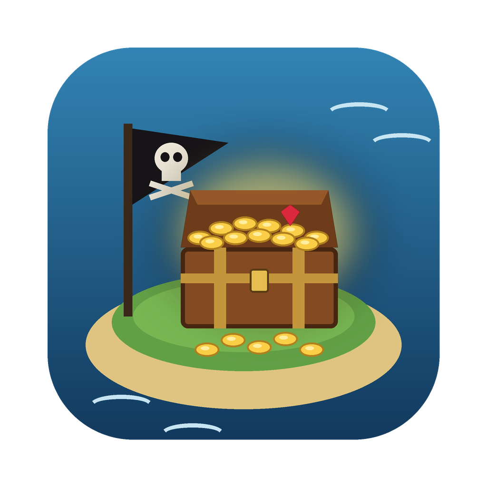
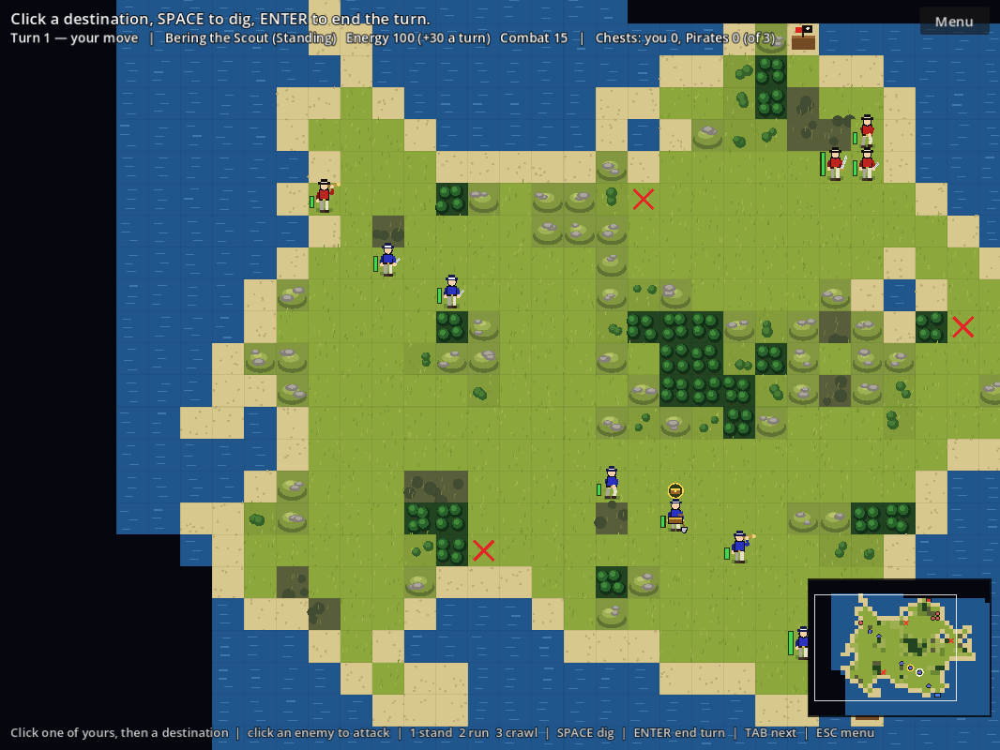
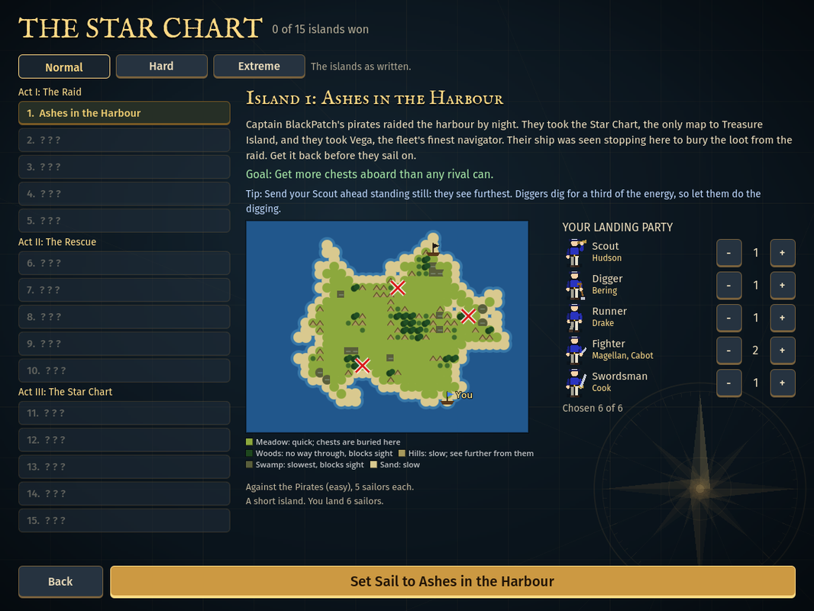
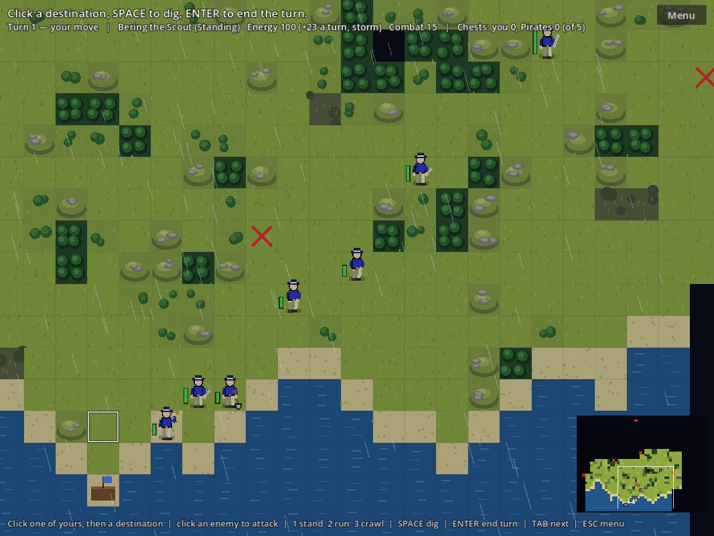
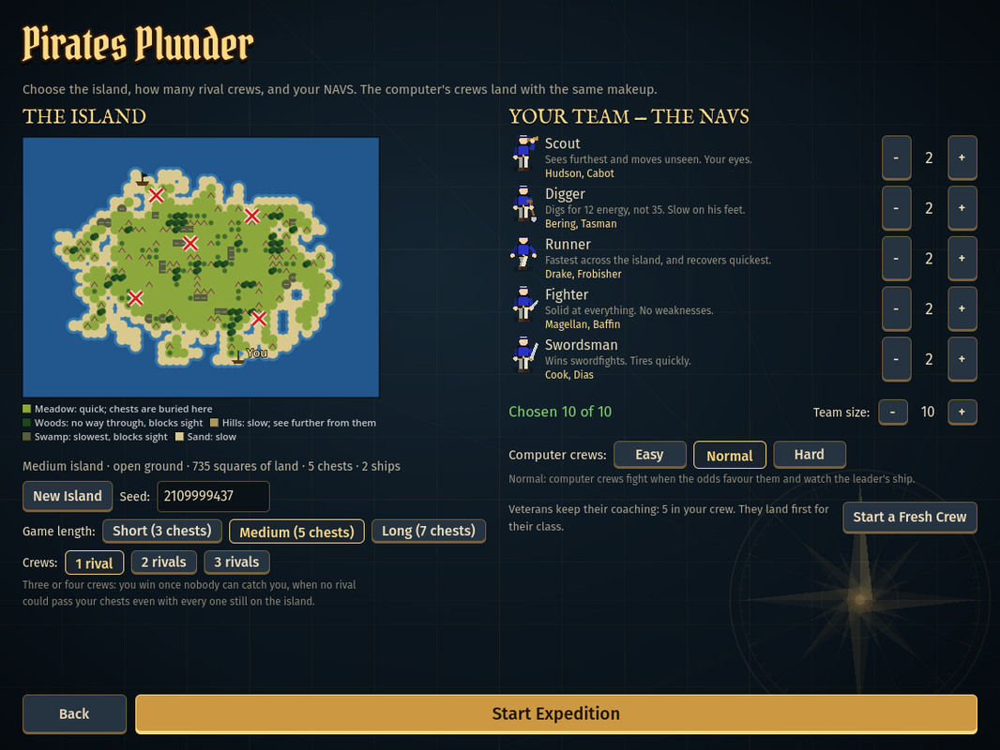

<h1 align="center">Pirates Plunder</h1>

  <b>A turn-based treasure hunt for one to four players.</b> 
  Land your crew on an island hidden in fog, dig up the chests buried by the red X's, 
  and get them aboard your ship before the pirates do.

  
  
  
  

  
  &nbsp;
  

  <a href="https://github.com/sparkly-quasar/Pirates-Plunder/releases/latest">Release notes and all downloads</a>
  &nbsp;·&nbsp;
  <a href="https://github.com/sparkly-quasar/Pirates-Plunder/releases/latest/download/PiratesPlunder-server-linux.tar.gz">Dedicated server (Linux)</a>

---

## What it is

Your crew of **NAVS** comes ashore beside your ship. Somewhere on the island,
chests are buried next to the red X's. Every step costs energy, and energy
only comes back at the start of your turn, so every move is a choice: send
the Scout ahead to look, dig with the Diggers, run the chest home with a
Runner, and keep a Fighter close in case the **PIRATES** find you. Walk into
an opponent and it's a sword fight. Get more than half the chests aboard, or
capture every opponent, and the island is yours.

Win, and you coach your crew for the next expedition: they keep their names,
their skills and their careers from game to game.

Inspired by the 1996 PC game *Richard Carr's Treasure Island*, and built with
[Godot 4](https://godotengine.org).

## Features

- **A 15-island campaign, *The Star Chart*.** Captain BlackPatch stole the
  Star Chart and captured Vega, the fleet's best navigator. Storms, guarded
  stockades, a pirate stronghold, ambushes and rival crews stand between you
  and Treasure Island. Once Vega is free, beaten pirates may change sides.
  Normal, Hard and Extreme levels.
- **A crew that grows with you.** Five classes (Scout, Digger, Runner,
  Fighter, Swordsman), a new recruit with every win, and one-to-one coaching
  between islands.
- **Multiplayer for up to four crews:** on one computer, friend to friend,
  or on a server you leave running. Free-for-all or 2v2, with chat, saved
  matches and automatic reconnecting.
- **Battle Royale:** every player brings the crew they've trained, and every
  crew is for itself on a big island.
- **Play on a phone** in the browser, laid out for the screen held sideways.
- **A Hall of Fame** on every server, a turn clock for online games, and a
  tutorial that teaches the whole game in a few minutes.

<table>
  <tr>
    <td width="50%"></td>
    <td width="50%"></td>
  </tr>
  <tr>
    <td align="center">The campaign: each island has its own story, rules and tip</td>
    <td align="center">Storm Reef: rain cuts your crew's rest</td>
  </tr>
  <tr>
    <td width="50%"></td>
    <td width="50%">
      <b>Every island is different.</b> Pick short, medium or long, one to
      three rival crews, and how sharp the computer plays. The chart shows
      the ground before you land: meadow where chests are buried, woods to
      hide in, hills to see from, swamp to avoid.
    </td>
  </tr>
  <tr>
    <td align="center">Choosing the island and the crew</td>
    <td></td>
  </tr>
</table>

## Download and play

| Where | How |
|---|---|
| **Mac** | [Download `PiratesPlunder-macos.dmg`](https://github.com/sparkly-quasar/Pirates-Plunder/releases/latest/download/PiratesPlunder-macos.dmg), open it, and drag **Pirates Plunder** onto **Applications**. The app isn't signed by Apple yet, so the first time, right-click it and choose **Open**. |
| **Windows** | [Download `PiratesPlunder-windows.exe`](https://github.com/sparkly-quasar/Pirates-Plunder/releases/latest/download/PiratesPlunder-windows.exe) and run it. Windows may warn about an unrecognised app: choose **More info**, then **Run anyway**. |
| **Phone or browser** | Open the address of a Pirates Plunder server (see [Play on a Server](#ways-to-play) below). |
| **Server** | [Download the Linux server](https://github.com/sparkly-quasar/Pirates-Plunder/releases/latest/download/PiratesPlunder-server-linux.tar.gz) and see [Run a server](#run-a-server). |

Each release lists its changes on the
[Releases page](https://github.com/sparkly-quasar/Pirates-Plunder/releases).
Once installed, the game updates itself: **Check for Updates** on the main
menu finds the latest release here, downloads it, checks it against the
release's fingerprints and restarts. Joining a friend or a server with a
newer copy offers the update too.

## How to play

New to it? **Single Player → Tutorial** walks you through everything below.

- Click one of your crew, then click where they should go. Every square costs
  energy (more in woods and on hills), and energy only comes back at the
  start of your turn.
- **1** stand (sees furthest), **2** run (fast, sees little), **3** crawl
  (slow, hardest to spot).
- **Space**, or double-click a sailor, digs where they stand. Chests are
  always buried in open meadow, in one of the eight squares around a red X.
- Carry a chest to your ship. Carrying doubles the cost of every step, so
  hand it on: select someone with empty hands and double-click the carrier.
- Walk into an opponent, or click one, to fight. Each side secretly picks a
  cautious or aggressive move, and rested sailors fight hardest. The loser
  is captured, and a captured carrier's chest changes hands.
- **Enter** ends your turn. **Esc** opens the menu: pause, volume, saving,
  and the full list of controls.
- The view stays where you put it: drag, the arrow keys, the wheel or the
  mini-map move it, and **C** jumps to whoever is selected.

On a phone: tap to select and move, drag to look around, pinch to zoom, and
a bar of big buttons stands in for the keys.

## Ways to play

<b>Single Player</b>: the campaign, quick games against the computer, and the tutorial

- **Campaign: The Star Chart.** Fifteen islands in order, each the same for
  everyone, with its own rules: storms, head starts, two and three rival
  crews, and rivals that get better drilled as you go. On island 7 you free
  Vega from a guarded stockade; after that she sails with you, a Navigator
  with skills no recruit starts with. On island 12 the Star Chart is buried
  under a gold X; later islands start fully mapped. Win Treasure Island for
  the ending and the **Golden Rooster**: your ship flies it from then on, in
  single player and in every online game. Normal, Hard and Extreme each keep
  their own progress, and your crew is the same in all three.
- **Against the Computer:** race one to three computer crews on any island
  you like. Choose Easy, Normal or Hard. Each win brings a new recruit of the
  class you choose, and coaching works one person at a time: everyone gets
  one try at a skill or an attitude.
- **Your Crew** shows everyone you've been training: their skills, how far
  coaching can take them, their confidence and their lifetime careers. It's
  kept automatically after every game.
- **Tutorial:** a guided island that walks a new player through selecting and
  moving, stances, ending the turn, digging, carrying and handing over a
  chest, the menu and a sword fight, moving on as each step is done.

<b>Multiplayer</b>: one computer, friend to friend, or a server

- **Players Sharing One Computer:** two to four crews, passing the mouse
  between turns. A screen hides the board while you swap. Any crew can be
  given to the computer instead.
- **Play Direct:** up to three friends join over the same Wi-Fi, or over the
  internet with [Tailscale](https://tailscale.com/download). Seats nobody
  fills can go to the computer, and if a friend drops out mid-game the
  computer takes over their crew. The Host and Join screens walk you through
  it; full steps are in [godot/README.md](godot/README.md#playing-online).
- **Play on a Server:** someone leaves a dedicated server running, at home or
  on a small rented machine. **Play on a Server** lists the servers on your
  Tailscale network: start a game on a free one, choosing the crews and the
  island, and your friends join it from the same list. A server elsewhere
  can be typed in by address. Running one:
  [godot/SERVER.md](godot/SERVER.md).
- **Free-for-all or 2v2:** with four crews, play every crew for itself or two
  sides of two. Partners share what they see, can't fight each other, pass
  each other chests, and their chests count together.
- **Battle Royale:** every crew for itself on a big island, each player
  bringing the crew they've trained in single player, whole and uncapped. A
  short match of 1, 3 or 5 rounds; the most rounds won takes it. Vega sails
  only in the final round, unless whoever sets it up lets her sail every
  round.
- **Turn clock:** online games can have a turn limit (none to 5 minutes;
  servers start at 3). A clock beside the Menu button shows whose turn it is
  and the time left.
- **Chat** to everyone, or in 2v2 just to your side (press **T**).
- **Online matches save** after every game, and **Continue Online Match**
  picks one up again with each friend's crew. A lost connection reconnects
  by itself; with friends, the game pauses while you're gone.
- **Hall of Fame:** each server keeps every player's lifetime record there
  (games, wins, Battle Royale titles, chests aboard, captures). Press **Hall
  of Fame** beside a server in Play on a Server.
- **Different versions?** The older copy offers to download the newer one
  straight from the other player or the server, and update itself.

<b>On a phone, or in any web browser</b>

A server hands out the game itself. On a phone, with the Tailscale app on,
open the server's **https://** address (whoever runs it sets that up with
`tailscale serve`, for example `https://<machine>.<tailnet>.ts.net:10000/`)
and play alongside the Mac and Windows copies. Browsers only run the game
over https, except on the server's own machine (`http://localhost:24682/`).

It's laid out for the screen held sideways. To keep it on your home screen,
use **Share → Add to Home Screen** (iPhone, Safari) or the menu's **Add to
Home screen** (Android, Chrome). See
[godot/SERVER.md](godot/SERVER.md#players-in-a-web-browser-and-on-phones).

<b>Islands, saving and windows</b>

Every game can be **Short**, **Medium** or **Long**: a bigger island with more
chests (3, 5 or 7 for two crews). More crews get a much bigger island and more
chests: 5, 8 or 11 for three crews, and 7, 11 or 15 for four, with a ship on
each side and the X's laid out so no crew starts closer to the treasure than
the others. With three or four crews you win once nobody can catch you, and
a scoreboard shows who's leading.

Press **Esc** in a game to **Save Game** into one of three slots. **Continue**
on the main menu picks up the newest save; **Saved Games** lists all three.

On a Mac or Windows the game opens in a big window the first time, and after
that the way you left it: the same size and place, or full screen.

## Run a server

A dedicated server is a copy of the game with no crew of its own, left
running so friends (or anyone) can start and join games without anyone
keeping their own computer on. It hands phones and browsers the game
itself, keeps itself on the latest release (switching while nobody is
playing), and brings older copies up to date as they connect.

- **For friends:** run it at home and share the machine with them in
  [Tailscale](https://tailscale.com); it shows up in their server list.
- **For anyone:** a small Linux VPS, Docker, and Caddy for HTTPS. Follow
  [A public server, step by step](godot/SERVER.md#a-public-server-step-by-step).

Every setting, and how saving, the Hall of Fame and updates work on a
server, is in [godot/SERVER.md](godot/SERVER.md).

## For developers

The game lives in [`godot/`](godot/): open it in Godot 4.7. Design notes are in
[`DESIGN_REFERENCE.md`](DESIGN_REFERENCE.md), and the code layout and test
commands are in [`godot/README.md`](godot/README.md).
`godot/tools/package.sh` builds the Mac disk image and the Windows exe, and
each release's notes are in
[`godot/release-notes/`](godot/release-notes/).

## A note on the sounds

Pirates Plunder is a fan-made homage to Richard Carr's *Treasure Island*
(CarrSoft, 1996). The sound effects are clips taken from that original game,
and they belong to their creators. They're here as a tribute, not as my own
work, and nothing is charged for this game.

If the original developer, or whoever holds the rights, would like the clips
removed, I'm happy to do that straight away. Please open an issue on this
repository and I'll take them out. All of the game's audio goes through one
file ([`godot/scripts/audio_manifest.gd`](godot/scripts/audio_manifest.gd)),
so replacing them is quick. See
[`godot/PLACEHOLDER_ASSETS.md`](godot/PLACEHOLDER_ASSETS.md).

## License

The game's code, art and text are under the [MIT License](LICENSE): use,
change and share them freely, keeping the copyright notice. The sounds and
music from the original 1996 game aren't covered by it (see the note on the
sounds above, and [`NOTICE`](NOTICE)).
